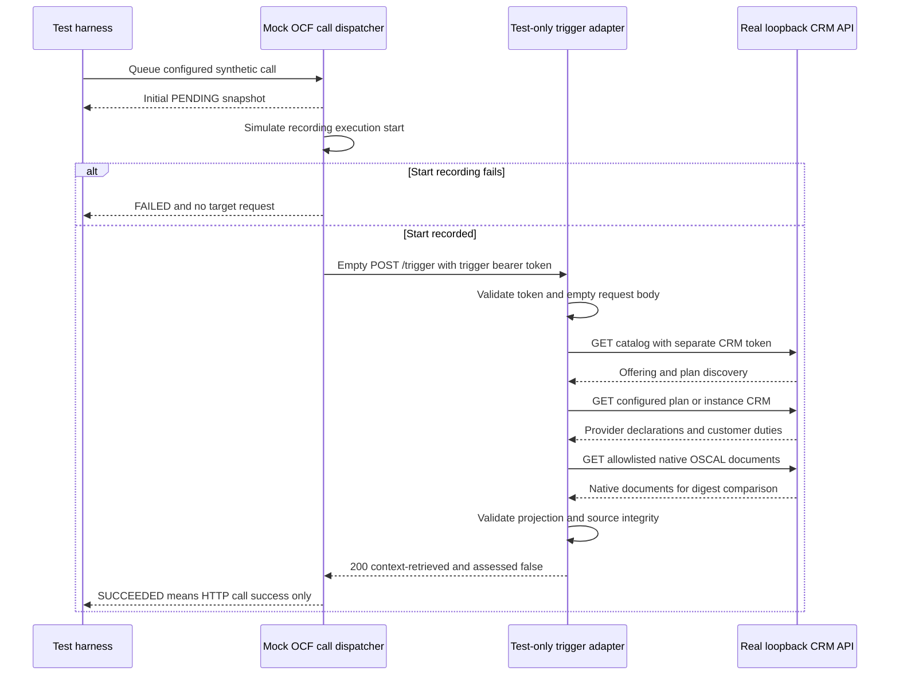

# Operational CRM API

## OCF scheduler interaction tests

Run only the scheduler series (existing cached OSCAL schemas are required):

```sh
node --test poc/oscal-crm/test/scheduler.test.mjs
```

Or run all checks with `node poc/oscal-crm/verify.mjs`. The scheduler series is
registered in that one-command verifier; it adds no dependencies, containers,
database, UAA grants or cloud deployment. All listeners bind ephemeral loopback
ports and close after each test.

### Pinned contract and what actually runs

Reference: [GSA-TTS/ocf-scheduler](https://github.com/GSA-TTS/ocf-scheduler),
`develop` revision `8f070f0aed8c622ec22b82a053a11af37d1de4dc`:

- `http/run_service.go`: a call sends an empty POST with the stored Authorization
  header after execution start is recorded. It does not send a tenant header.
- `http/run_service_test.go`: upstream tests cover start-recording retries and
  skipping target dispatch when start recording cannot succeed.
- `core/calls.go`: Call holds URL and AuthHeader.
- `http/routes/execute_test.go`: manual execute returns the stored execution
  snapshot, not later worker state.

`scheduler/contract-mock.mjs` is an explicitly labeled **test model**, not
imported or executed scheduler code. It captures request/state contract behavior
with bounded fetch and injected start-recording results. Its default is three
immediate simulated start attempts; upstream uses five attempts with exponential
backoff starting at one second. Timeout/redirect restrictions are local test
safety controls, not claims about upstream behavior. Upstream response-success
classification uses its HTTP library; the mock uses Fetch's 2xx `ok` definition.

`scheduler/adapter.mjs` is a **test-only POST-to-GET adapter**. It accepts a
configured empty POST, authenticates a dedicated trigger token, then uses a
different CRM token to GET catalog, CRM and referenced native documents. It
checks the strict projection schema and source digests, and never dereferences
an arbitrary URL. The configured synthetic tenant is used for instance requests;
the caller cannot select a tenant through headers or body. It has no CLI or
production deployment configuration.

The HTTP interactions run for real against `createApi()` on loopback; execution
storage, queue dispatch and start-recording failures are mocked. The real OCF
scheduler, PostgreSQL, UAA, cron timing, CF jobs, restart recovery and binding
pause/resume behavior **were not executed**. Real scheduler validation remains
within the already tracked scheduler integration acceptance gate (#79).

### Test matrix

| Scenario                                                          | Expected observation                                                       |
| ----------------------------------------------------------------- | -------------------------------------------------------------------------- |
| Direct scheduler-shaped POST to read-only CRM                     | HTTP 405; mocked execution FAILED                                          |
| Empty POST with stored Authorization                              | Header forwarded, no tenant header, zero body bytes                        |
| Start recording fails throughout / transiently                    | Zero target calls / exactly one target call                                |
| Manual dispatch                                                   | Initial PENDING snapshot distinct from terminal result                     |
| Trigger retrieves valid CRM                                       | 200; declared implemented/partial/unknown, duties and parameters preserved |
| Missing/wrong trigger token or CRM token used as trigger          | 401                                                                        |
| Wrong method/path, nonempty/oversized body                        | 405 / 404 / 400 / 413                                                      |
| Known instance with spoofed tenant header                         | Configured tenant used; no caller-selected identity                        |
| Unknown instance                                                  | Adapter 502; mocked execution FAILED                                       |
| Repeated read-only deliveries                                     | Stable projection digest; no source status changes                         |
| CRM 401/404/500, malformed JSON, schema/digest mismatch, redirect | Adapter 502, no partial success                                            |
| Slow/unavailable target                                           | Bounded transport or adapter failure                                       |
| Remote base URL, shared tokens, unapproved tenant                 | Configuration rejected                                                     |

Tokens and request bodies are omitted from adapter audit events, and tests assert
tokens do not appear in the collected audit logs. A successful trigger returns
`assessed: false`: retrieving declarations never establishes control compliance.

### Scheduler-to-CRM exchange



Fault tests substitute rejecting/malformed/slow loopback targets and inject
start-recording failures. They are not a live scheduler database outage proof.

## Local OSCAL document loading

The API now accepts a **local, digest-bound manifest** rather than depending on
fixed demo fixtures. The viewer discovers offerings/plans from `/v2/catalog`;
CRM, component, comparison, native-document and instance routes all use the
selected context snapshot.

```sh
node poc/oscal-crm/export-demo.mjs
node poc/oscal-crm/context.mjs poc/oscal-crm/.cache/demo/manifest.json
export CRM_CONTEXT_MANIFEST="$PWD/poc/oscal-crm/.cache/demo/manifest.json"
export CRM_API_TOKEN="$(node -e "console.log(require('node:crypto').randomBytes(32).toString('hex'))")"
node poc/oscal-crm/server.mjs
```

Open http://127.0.0.1:8787/ and enter the generated token. Omit
`CRM_CONTEXT_MANIFEST` for built-in synthetic defaults. Restart to load source
changes; there is no automatic reload or upload endpoint.

The generated `.cache/demo/manifest.json` demonstrates the complete input shape:

- `version: 1` and mandatory `synthetic: true`.
- `documents`: named contained relative paths plus SHA-256 byte digests. The
  `component` key selects the native component-definition.
- `plans`: offering/plan IDs, capability/control-implementation UUIDs, anchor
  and included component UUIDs, `documentName` selecting the consumer SSP, and
  explicit `claimBasis` mappings.
- `instances`: synthetic instance IDs, `demo-tenant`, and selected plan.

The strict schema is exported by `context.mjs`. Plan IDs must be unique across
the context; compared plans must belong to the same offering. Invalid mappings,
duplicate identifiers, corrupt digests and missing documents abort startup.

Limits: 64 KiB manifest, 2 MiB per document, 64 nesting levels, 17 documents,
16 plans, 32 component references per plan and 100 instances. Document paths
must remain below the manifest directory after symlink resolution. No parent
traversal, absolute document paths, remote URIs or executable loaders. The
manifest itself is an explicit operator-selected path, never HTTP input.

Use only non-sensitive synthetic documents: the manifest label is an operator
assertion, not a classifier or authenticity proof. Input byte digests verify
files; API source digests hash parsed JSON serialization and can differ when
file whitespace differs. Both are integrity checks, not signatures.

## Browser viewer and plan comparison

Start the server below and open **http://127.0.0.1:8787/**. Paste the generated
local token into the password field and select Connect. The viewer shows
provider implementations and customer requirements side by side, with expandable
component detail, effective parameters, source references and model notes.
The public viewer shell contains no CRM data; all data endpoints still require
authentication. Tokens are kept only in memory, cleared from the input and
discarded on Disconnect or page reload. No browser storage or URL tokens.

Choose **Managed** or **Enhanced**. Both plans compose identity, audit and
hosting components. Enhanced declares a managed application log destination and
changes application access reviews from 30 days to 7 days; customer event
selection remains required. These are synthetic plan declarations, not measured
improvements or a compliance ranking. SC-13 remains unknown in both plans.

`GET /api/crm/compare/managed/enhanced` returns changed row scopes, obligations
and parameters. `GET /api/oscal/ssp-enhanced` returns the enhanced native SSP.
Comparison is authenticated and includes source digests for both plans. The
viewer compares the first two discovered plans in the selected offering.

The one-command verifier includes live delivery of the viewer HTML/assets and
comparison API, but no automated real-browser engine is installed. Interactive
browser behavior requires manual validation; HTTP delivery is not a browser pass.

This **AI-assisted, synthetic proof of concept** makes control implementations
and customer responsibilities inspectable without claiming that provisioning
proves compliance. The HTTP server is real; the hosting service and all control
claims are fabricated. Human review is required before deployment.

## Bootstrap and verify

Prerequisites: Node 24 (tested), gitleaks, GitHub CLI authenticated for the currently
private `GSA-TTS/oscal-vault-core`, and the parent repository's existing Ajv and
ajv-formats packages. No new dependencies are installed.

From the repository root:

```sh
node poc/oscal-crm/bootstrap.mjs
node poc/oscal-crm/verify.mjs
```

Bootstrap fetches official OSCAL 1.1.3 schemas from immutable core revision
`1a127cf611d10aaf40a1f0e36fdc77172d5da564` into ignored `.cache/`, with SHA-256
values recorded in `.cache/manifest.json`. Core is private; public release is
TBD. Schemas are cached locally rather than republished here.

Verify checks formatting and secrets, JavaScript syntax, both native document schemas, UUID/reference
consistency, unit/HTTP tests, and a live loopback HTTP walkthrough. It writes
actual responses to ignored `poc/oscal-crm/proof.json` and closes its listener.
No source documents, credentials or private system CRM data are downloaded.

## Start the API

```sh
export CRM_API_TOKEN="$(node -e "console.log(require('node:crypto').randomBytes(32).toString('hex'))")"
node poc/oscal-crm/server.mjs
```

Keep the same environment in the terminal used for requests. The listener binds
only `127.0.0.1`; default port is `8787`, configurable via `CRM_API_PORT`
(integer 1024–65535). `CRM_API_TOKEN` must contain 32–128 URL-safe characters;
use random generation, never a checked-in value. Stop with Ctrl-C. This uses
HTTP **only for approved synthetic loopback development**. Do not expose it
through a tunnel, LAN binding or reverse proxy without an approved TLS and
authorization design.

```sh
curl --fail-with-body -H "Authorization: Bearer $CRM_API_TOKEN" \
  http://127.0.0.1:8787/api/crm/offerings/managed-hosting/plans/managed

curl --fail-with-body -H "Authorization: Bearer $CRM_API_TOKEN" \
  -H 'X-CRM-Tenant: demo-tenant' \
  http://127.0.0.1:8787/api/crm/instances/demo-instance
```

## Routes

All routes require bearer authentication; the single configured token grants
access to the single synthetic tenant. The tenant header is an additional scope
check, **not an identity assertion trusted for multi-tenant authorization**.

| Route                                                  | Result                                                                    |
| ------------------------------------------------------ | ------------------------------------------------------------------------- |
| `/health`                                              | Authenticated health check                                                |
| `/v2/catalog`                                          | OSBAPI-shaped mock discovery with CRM link; not a complete broker         |
| `/api/crm/offerings/managed-hosting/plans/managed`     | Plan-level CRM rows                                                       |
| `/api/crm/instances/demo-instance`                     | Requires `X-CRM-Tenant: demo-tenant`; includes fixture parameter snapshot |
| `/api/components/10000000-0000-4000-8000-000000000002` | Component, capability, controls, source and notes link                    |
| `/api/oscal/component`                                 | Native component-definition JSON                                          |
| `/api/oscal/ssp`                                       | Native consumer SSP JSON                                                  |
| `/api/notes/component-model`                           | Detailed model notes as JSON-wrapped Markdown                             |
| `/api/openapi.json`                                    | OpenAPI 3.1 route description                                             |

Requests with queries/invalid paths return 400; unauthorized requests return
401; unsupported methods return 405; missing or wrong-tenant context returns
404 without revealing instance ownership. Responses use `no-store`; document
digests and ETags permit integrity comparison, not proof of authenticity.
Audit events contain UTC timestamps, method, sanitized route and status, never
tokens or request bodies.

## What the CRM shows

| Control | Provider-declared implementation                 | Customer requirement                                         | Evidence     |
| ------- | ------------------------------------------------ | ------------------------------------------------------------ | ------------ |
| AC-2    | Implemented for hosting-plane account management | Manage/review application accounts every 30 days             | Not assessed |
| AU-2    | Partial: hosting-plane events only               | Select application audit events and configure destination    | Not assessed |
| SC-13   | Unknown cryptographic implementation             | Obtain provider evidence and document application protection | Not assessed |

Each row retains native `provided`/`responsibilities` UUIDs, role references,
statement identifiers, effective parameters and source identifiers. Provider
defaults versus explicit plan configuration are separate claim-basis metadata.
No `inherited` or `satisfied` record is invented. Missing customer facts remain
`unknown`, never “no customer work.” See [component-model notes](notes/component-model.md).

## Boundaries

- No real broker provisioning, bindings, database, cloud calls or CF round-trip.
- No assessment evidence or authoritative implemented/ATO status; declarations
  remain declarations. All observations are explicitly `not-assessed`.
- One synthetic offering, two plans, three components and one tenant; no multi-tenant token
  management, production rate limiting, revocation or persistence.
- Official schema validation is not full FedRAMP constraint or baseline
  validation. The `urn:example:baseline` reference is intentionally synthetic.
- #82 and #83 remain open: this demonstrates the local API slice, not their
  full reviewer, real broker and CF acceptance gates.

These boundaries remain within the already tracked #82/#83 work, not additional
authorization to deploy. Rollback: stop the listener and revert only the
prototype/ADR changes through normal review. Existing work is untouched.

## Verification transcript

Scheduler increment: `node --test poc/oscal-crm/test/scheduler.test.mjs` passed
eleven scheduler contract/HTTP tests with zero failures or skips. Full verification
includes these alongside the eleven existing tests. No upstream source was
vendored, scheduler process started, dependency installed or cloud API invoked.

Document-loading increment: eleven tests include local JSON round-trip and live
HTTP against renamed offering/plan IDs, proving routes use the loaded context.
Negative tests cover corrupt digests, traversal, escaping symlinks, oversized
files, reserved keys, duplicate plans, missing documents and invalid tenant
configuration. Main HTTP proof uses the generated manifest. No dependencies
installed. Interactive browser and Mermaid visual validation remain BLOCKED.

Second increment, 2026-10-28T18:49:57Z: nine tests passed, zero failures/skips;
managed/enhanced comparison and viewer asset delivery returned 200. Both consumer
SSPs passed native validation. Initial duplicate SSP schema registration failed;
reused the compiled validator and reran all checks successfully. Formatting and
secrets scans passed. Real interactive browser validation remains BLOCKED by the
absence of an installed browser automation harness; no browser pass is claimed.

AI-assisted scoped-edit run on 2026-10-28 (UTC); actual HTTP responses are
captured separately in ignored `proof.json`.

| Command / check                                                                                         | Observed result                                                                                                        |
| ------------------------------------------------------------------------------------------------------- | ---------------------------------------------------------------------------------------------------------------------- |
| `node poc/oscal-crm/bootstrap.mjs`                                                                      | PASS: pinned official OSCAL 1.1.3 schemas cached; no packages installed                                                |
| `node_modules/.bin/oxfmt --check poc/oscal-crm docs/adr/0006-use-native-oscal-for-crm-api-prototype.md` | Initial formatting FAIL; formatted only new files and rechecked PASS                                                   |
| `gitleaks dir poc/oscal-crm --redact --no-banner --config .gitleaks.toml`                               | PASS: no leaks found                                                                                                   |
| `node poc/oscal-crm/verify.mjs`                                                                         | PASS: syntax, component/SSP schemas, strict CRM projection contract, seven tests, zero failures/skips, live HTTP proof |
| Live authenticated catalog/CRM/component/native documents                                               | HTTP 200                                                                                                               |
| Missing auth / wrong tenant / invalid query                                                             | HTTP 401 / 404 / 400 respectively                                                                                      |
| Unsupported method                                                                                      | HTTP 405 in HTTP integration test                                                                                      |
| `git diff --check`                                                                                      | PASS: no whitespace errors in tracked diff                                                                             |

No compilation step is needed for the Node ESM sources; `node --check` is the
syntax/build check. SAST, dependency vulnerability scanning, repository-wide
Gatsby/Backstage builds and CI were not run; no dependency changes were made.
The isolated prototype's checks are not a repository-wide or production security
approval. No commits, issue closure, cloud deployments or CF validation occurred.
