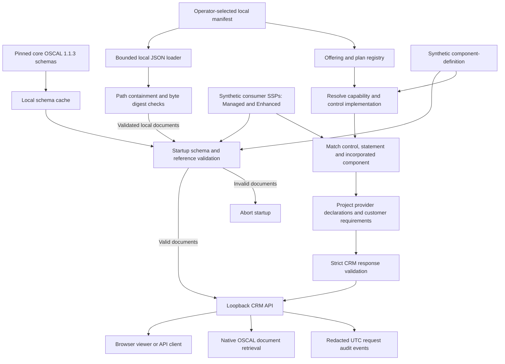
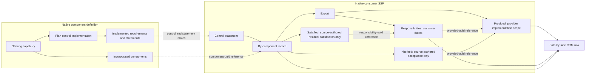
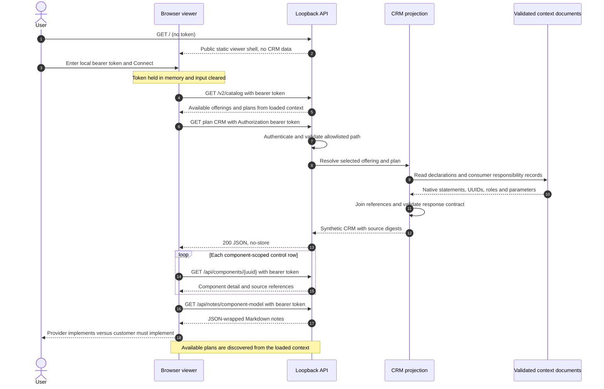
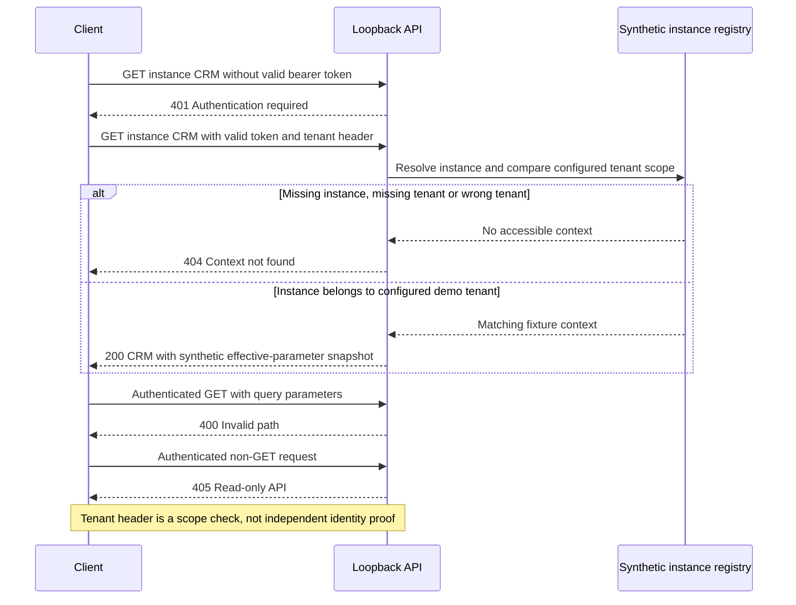
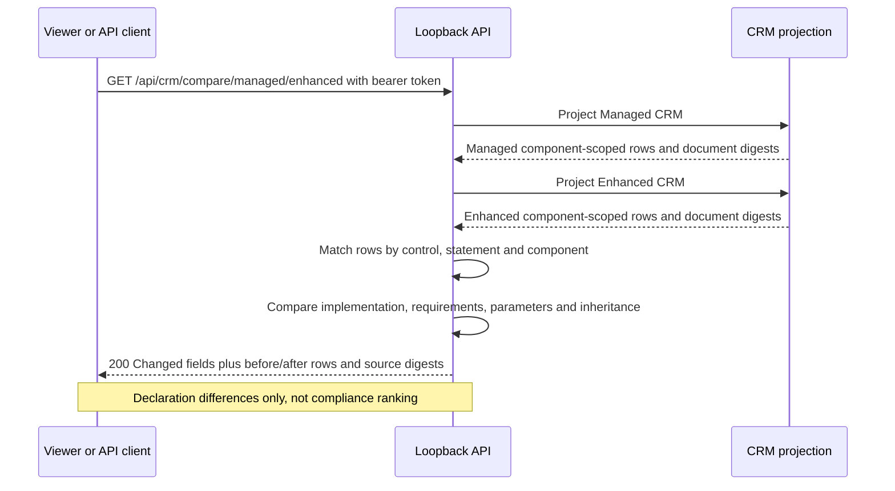

# Component model: what is implemented versus what is required

## Plan composition increment

Managed and Enhanced incorporate three native components: hosting (`…000002`),
identity (`…000020`) and audit (`…000021`). AC-2 rows reference identity; AU-2
references audit; SC-13 references hosting. The top-level `component_uuid` is
the offering's hosting anchor; each CRM row identifies the actual implementing
component and must resolve to an incorporated component in the native documents.

Enhanced selects a second native capability control-implementation UUID and a
separate consumer SSP. It declares the audit destination provided, while retaining
customer event selection/delivery verification. Identity reviews change to 7 days.
Comparison keys include control, statement and component, not control alone.
Both plans remain unassessed; changed declarations never become observed results.

AI-assisted modeling notes; all example assertions are synthetic. A component
implements a **scope of a control**, not necessarily the entire customer system
control. Therefore the CRM must retain the implementation scope and residual
customer duty instead of reducing a control to one green badge.

## Native structure

### Data flow: native documents to CRM rows

This diagram describes the running document-backed prototype with synthetic
defaults and an optional local manifest. Component-definition declares
capabilities; the consumer SSP supplies the machine-readable responsibility split.

Schema validation and projection validation serve different purposes: native
schemas check OSCAL structure, while projection validation checks the API
contract. Neither establishes that a declared implementation was assessed.

### Model boundaries: provider does versus customer must do

`inherited` and `satisfied` are optional source records, absent in the current
fixtures. The API does not create them from the existence of a provider claim.
Evidence remains `not-assessed`; missing status or customer facts stay unknown.

### API exchanges: discovery, CRM and component detail

API clients can discover the plan list using authenticated `GET /v2/catalog`,
then follow each plan's `metadata.crm_href`. The browser now discovers offerings
and plans from that catalog. Notes are currently displayed as Markdown text,
including Mermaid source; the viewer does not include a Mermaid renderer.

### Instance isolation and failure exchanges

### Plan comparison exchange

The current comparison reports AC-2 review-period/customer-duty changes and AU-2
provider-scope/customer-duty changes. SC-13 remains unknown in both plans. A
missing plan returns 404 rather than an empty comparison implying equivalence.

1. **Offering → capability.** The managed-hosting offering selects a native
   component-definition capability by UUID.
2. **Plan → control implementation.** An explicit fixture registry maps the
   managed plan to a capability control-implementation UUID. This mapping is
   projection metadata, not a new native OSCAL assembly.
3. **Resource → component.** The capability incorporates the hosting-plane
   service through `incorporates-components[].component-uuid`.
4. **Declared implementation → implemented requirement / statement.** Preserve
   control IDs, statement IDs, narratives, roles and set-parameters.
5. **CRM split → consumer SSP by-component export.** Machine-readable provider
   statements belong in `export.provided`; customer duties belong in
   `export.responsibilities`. Responsibilities retain `provided-uuid` links.
   These assemblies do **not** belong inside component-definition.
6. **Acceptance → inherited / satisfied.** Inheritance and customer satisfaction
   require their own source-authored UUID references. None are asserted by this
   fixture; the API reports pending provider evidence and an empty satisfaction
   list, not automatic acceptance.

## Detailed example component

**Synthetic managed hosting**, UUID
`10000000-0000-4000-8000-000000000002`, includes provider hosting-plane service
account management and audit collection. It excludes application authorization,
application account lifecycle and application-specific event selection. The
provider operator owns hosting-plane duties; the customer owner owns residuals.

AC-2 declares hosting-plane account management implemented; the customer must
define application account types, remove departed users and review access every
30 days. AU-2 declares partial scope: hosting events exist, but application event
selection and routing remain required. SC-13 is unknown, so the CRM explicitly
requires provider evidence rather than fabricating cryptographic compliance.

The API returns the raw OSCAL status separately from `claim_basis`, evidence
state, customer obligations and inheritance acceptance. No system-operational
status is mapped to control implementation status. A successful HTTP request
means the projection was retrieved, not that a control was tested.

## Provenance and context

- Core schema reference: `GSA-TTS/oscal-vault-core` revision
  `1a127cf611d10aaf40a1f0e36fdc77172d5da564`, OSCAL 1.1.3. Currently private;
  public release TBD. The interoperability notes linked by its README are not
  in that revision's tree.
- Modeling guidance: `GSA-TTS/oscal-vault` revision
  `06763fb02b5913616cd6e501eb17f6d002b310f9`,
  `docs/osbapi-backstage-interop/capabilities-as-osbapi-offerings.md`. Its prose
  distinguishes native assemblies correctly; illustrative diagrams incorrectly
  place exports under component-definition, so schemas govern implementation.
- Additional context: `GSA-TTS/TTSE-petrified-forest-sspp` revision
  `812403d287d590d1a224f37ea2342e1bea6b35cc`,
  `schemas-local/system-crm.schema.json`. Its separation of tenant obligations,
  provider evidence, inheritance acceptance and implementation state informed
  this projection. It is private; no system CRM data was imported or republished.
- Scope and acceptance: cloud-sandbox #82 and #83. Native schema validity is
  tested here; control assertions and actual CF compatibility still need the
  separately tracked acceptance reviews.

## Integrity and security

### Scheduled retrieval is not assessment

The scheduler contract tests and Mermaid exchange are documented in
`poc/oscal-crm/README.md` under **OCF scheduler interaction tests**. They pin the
OCF scheduler's HTTP call behavior to revision
`8f070f0aed8c622ec22b82a053a11af37d1de4dc` and distinguish a mocked dispatcher
from real loopback API requests. A direct POST is rejected by this read-only CRM;
a separate test-only trigger adapter makes authenticated GETs, validates the
projection/digests and returns `assessed: false`. No scheduler or adapter outcome
changes provider status, inherited acceptance or residual satisfaction.

Canonical fixture serialization is SHA-256 hashed and references both native
documents. A digest is an integrity check, not a signature or authorization.
Documents and notes are retrieved only from local allowlisted routes, never a
caller-supplied URI. No untrusted URLs are dereferenced. One environment token
authorizes only the synthetic tenant; a tenant header alone never grants access.
Logs omit tokens, query values, bodies and user identities.
